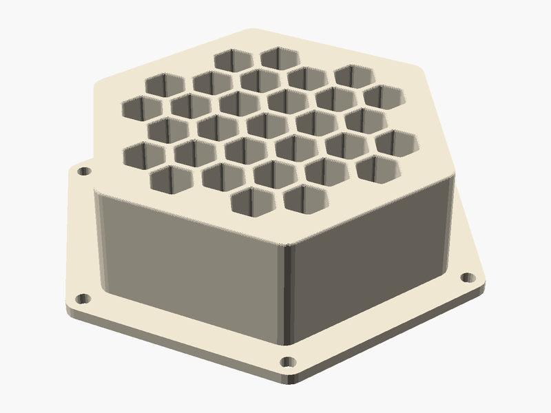

# Hive House

**Created by:** Luna

This is a bee house for solitary bees, like mason bees and leafcutter bees. Unlike honeybees, these bees don't live in a big hive. Each one finds a small tunnel to lay its eggs in, and every hole in this honeycomb is a tunnel they can use. You screw it onto a fence, post or wall near your flowers. Solitary bees are amazing pollinators, so giving them a safe place to nest helps your garden grow more fruit, flowers and seeds!

## Printed with PHA 🌱

**What is PHA?** PHA is a plastic made by tiny microbes! They munch on plant sugars and oils and store the PHA inside their bodies, kind of like how we store energy.

**Why is it eco-friendly?** It comes from plants instead of oil. And when it's all done, it can break down back into nature (in soil, and even in the ocean) instead of hanging around for hundreds of years.

**Printing tips:**
- 🧊 **Keep it cool:** set the nozzle to about 190–200 °C.
- 💨 **Lots of air:** turn the cooling fan up high and leave the printer doors or lid open.
- 🐢 **Go a little slower:** slower prints help each layer stick and cool nicely.
- ☀️ **Keep it dry:** store the spool in a bag with a desiccant pack so it doesn't soak up water.
